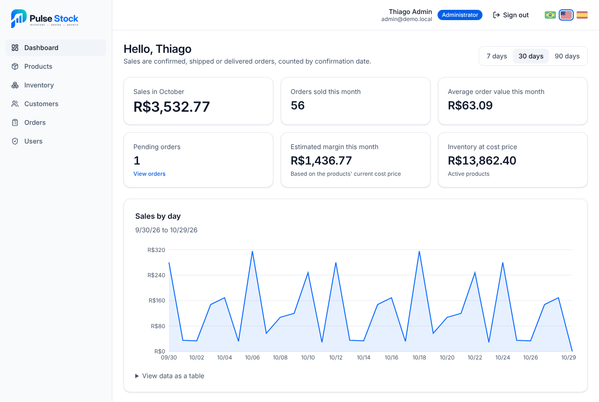
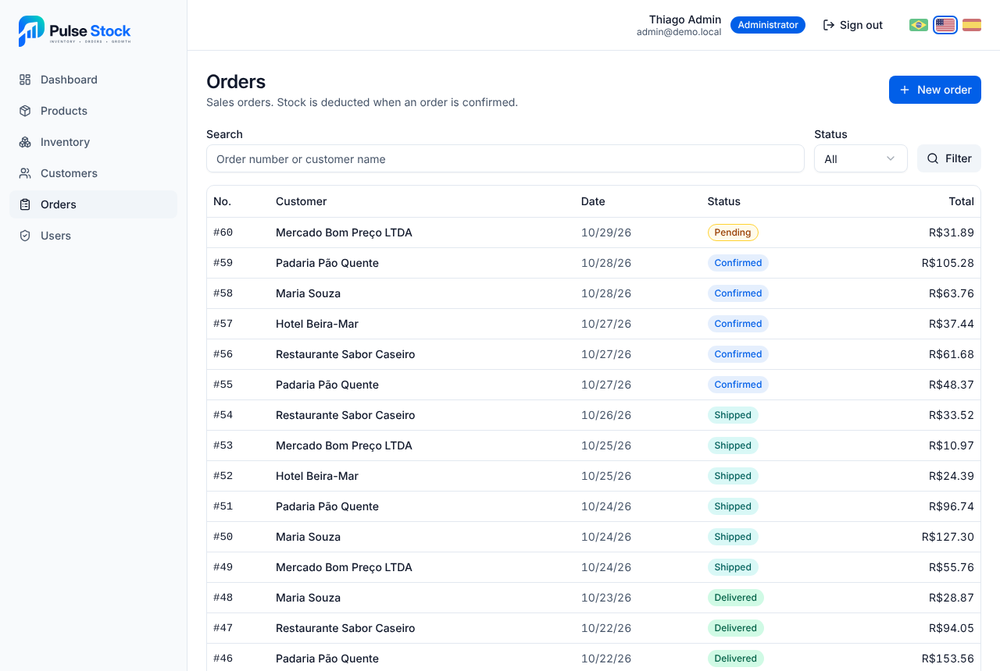
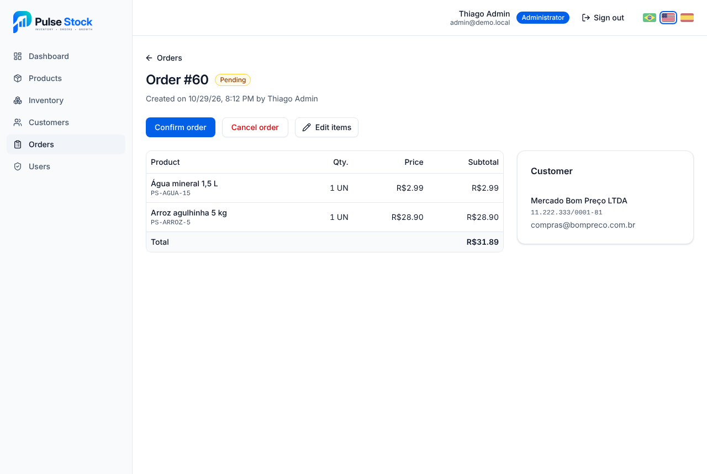
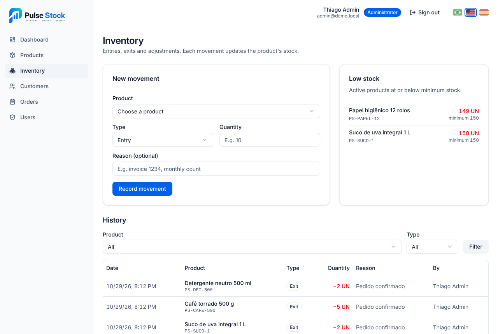
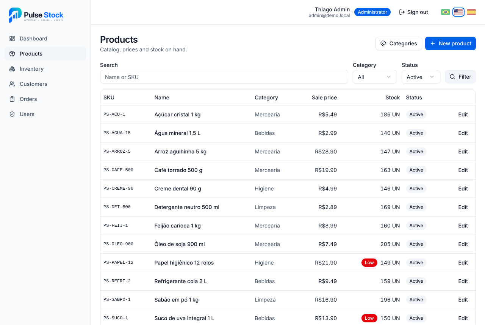
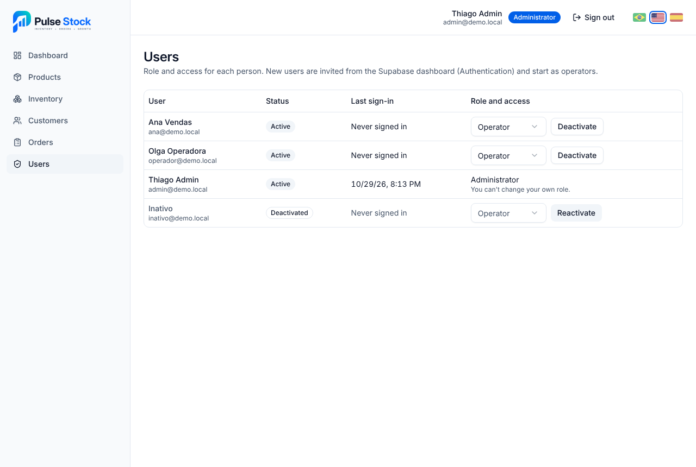
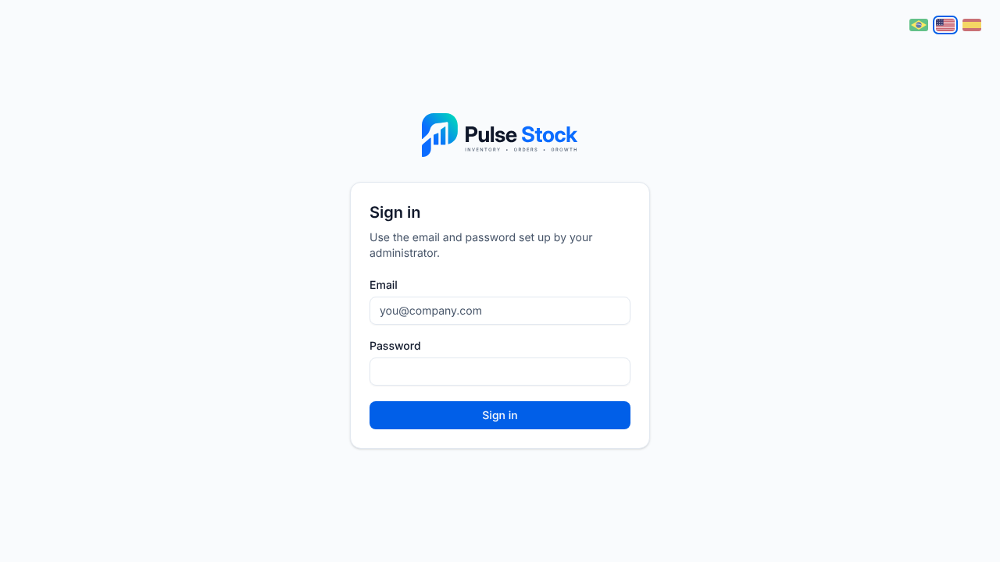
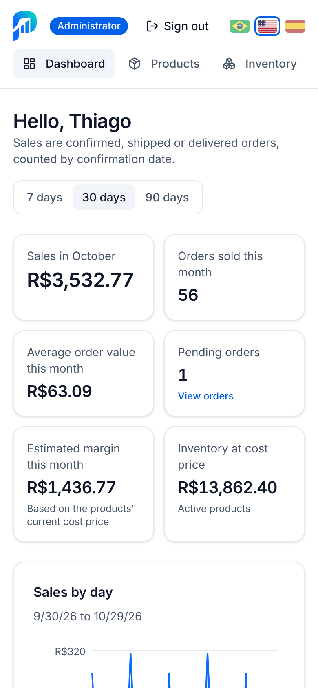

<p align="center">
  
</p>

<h1 align="center">Pulse Stock — mini ERP for inventory and orders</h1>

<p align="center">
  Products, inventory, customers, sales orders and a dashboard with the month's numbers, with the business rules enforced by the database itself.
</p>

<p align="center">
  <a href="README.md">Português</a> · <strong>English</strong> · <a href="README.es.md">Español</a>
</p>

<p align="center">
  <a href="https://github.com/vidaltechnologies/pulsestock/actions/workflows/ci.yml"></a>
  
  
  
  
  
  
</p>

<p align="center">
  
</p>

## About the project

Pulse Stock is a mini ERP for a small distributor: it registers products and customers, tracks stock levels, records sales orders and shows on a dashboard how sales are going. It is a portfolio project, built in 11 stages with one pull request each.

The rules that must never fail live in PostgreSQL, not only in the UI: role-based permissions with Row Level Security, stock that changes only through movements, stock deducted when an order is confirmed, and totals computed by triggers. Each rule has a verification script that runs in CI.

### Goals

- Show a complete management system, from login to dashboard, with code that is easy to read.
- Enforce access and inventory rules in the database, so no API call can bypass them.
- Use what Next.js and Supabase already offer before adding services or dependencies.
- Deliver accessible screens (WCAG 2.1 AA) that work on phones.

## Features

- **Two roles:** the admin manages everything; the operator registers customers and orders and records stock entries.
- **Products and categories:** search by name or SKU, filters by category and status, cost and sale prices, and minimum stock.
- **Inventory:** entries, exits and adjustments with an immutable history, a balance that never goes negative, and a low-stock alert.
- **Customers:** Brazilian CPF or CNPJ with check-digit validation, search and deactivation.
- **Sales orders:** items with frozen prices, automatic totals, a pending → confirmed → shipped → delivered flow, and cancellation that returns the stock.
- **Dashboard:** the month's sales, orders and average ticket, charts of daily sales, best sellers and orders by status, for 7, 30 or 90 days. Margin and inventory value are shown only to the admin.
- **Users:** the admin changes roles and activates or deactivates accounts; a deactivated user loses access immediately.
- **Password recovery:** a "Forgot your password?" link on the sign-in screen, an email with a single-use link and a screen to set the new password.
- **REST API:** versioned routes under `/api/v1` for products, inventory, customers, orders, dashboard and users, with Bearer tokens, Zod validation, standard error responses, OpenAPI docs and a Postman collection. See the [API](#api) section.
- **Demo data:** 16 products, 10 customers and about 110 orders from the last 60 days, created through the same functions the app uses.
- **Three languages:** Portuguese, English and Spanish, picked with the flags at the top of the screen. Text, error messages, numbers and dates all change; on a first visit the browser language is used.

## Screens

| | |
| --- | --- |
|  |  |
| Orders: search by number or customer and filter by status | Order: items, total, customer and status actions |
|  |  |
| Inventory: movements, minimum-stock alert and history | Products: search, category and status |
|  |  |
| Users: role and access, admin only | Login |

<p align="center">
  
  <br>
  <sub>Dashboard on a phone</sub>
</p>

## Technologies

| Technology | What it is for |
| --- | --- |
| Next.js 16 (App Router) | Server-rendered pages and API routes (Route Handlers) |
| React 19 + TypeScript | UI and end-to-end typing |
| Tailwind CSS 4 + shadcn/ui | Styling and accessible components |
| Supabase (PostgreSQL + Auth) | Database, login, RLS, triggers and functions |
| Zod + React Hook Form | Validation shared by forms and API |
| Recharts | Dashboard charts |
| OpenAPI 3.1 + Swagger UI | API documentation, generated from the Zod schemas |
| Vitest | Unit tests and API integration tests |
| GitHub Actions | CI: lint, types, tests, build, database checks and API tests |

## Running it on your computer

Requirements: Node.js 20.9 or later and a [Supabase](https://supabase.com) project (or Docker, to run Supabase locally).

```bash
git clone https://github.com/vidaltechnologies/pulsestock.git
cd pulsestock
npm install
cp .env.example .env.local   # fill in the Supabase URL and publishable key
npm run dev                  # http://localhost:3000
```

| Command | What it does |
| --- | --- |
| `npm run dev` | Development server |
| `npm run build` | Production build |
| `npm run lint` · `npm run typecheck` · `npm test` | ESLint, TypeScript and unit tests |
| `npm run db:start` · `npm run db:reset` | Starts local Supabase and rebuilds the database with migrations and demo data |
| `npx supabase db push` | Applies the migrations to the linked cloud project |
| `npm run db:seed` | Loads the demo data into the linked project (only once) |
| `npm run db:test:rls` (and `stock`, `orders`, `dashboard`, `users`) | Checks the rules on the linked database without saving anything |
| `npm run test:api:setup` · `npm run test:api:serve` · `npm run test:api` | API integration tests against a local Supabase (needs Docker) |
| `npm run postman` | Regenerates the Postman collections from the spec |

Users are created in the Supabase dashboard (Authentication → Users) and start as operators. The database, access rules, API routes, CI and Vercel deployment are detailed in the [technical reference](docs/referencia-tecnica.md) (in Portuguese).

## API

The app has its own REST API under `/api/v1`. Supabase sits behind it as the database and login: API clients never talk to it directly, and the same database access rules apply to every call.

- **Interactive docs:** [`/api/docs`](http://localhost:3000/api/docs) (Swagger UI), with the OpenAPI 3.1 spec at `/api/v1/openapi.json`. It comes from the same Zod schemas that validate the requests.
- **Authentication:** `POST /api/v1/auth/token` exchanges email and password for an `accessToken`, sent in the `Authorization: Bearer` header. When it expires, `POST /api/v1/auth/refresh` with the `refreshToken` issues a new one.
- **Conventions:** success in `{ "data": ... }`, lists with `pagination`, errors in `{ "error": { "code", "message" } }` in the `Accept-Language` language, sorting with `sort=field` or `sort=-field`, and `X-Request-Id` on every response.

```bash
# 1. Get a token
curl -s -X POST http://localhost:3000/api/v1/auth/token \
  -H "Content-Type: application/json" \
  -d '{"email":"you@example.com","password":"your-password"}'

# 2. Use the accessToken from the response: low-stock products, lowest balance first
curl -s "http://localhost:3000/api/v1/products?lowStock=true&sort=stockQuantity" \
  -H "Authorization: Bearer <accessToken>"
```

### Postman

1. In Postman, use **Import** with two files from the [`postman/`](postman/) folder: the collection in your language (`pulse-stock.en`, `.pt` or `.es.postman_collection.json`) and the *Pulse Stock (local)* environment. In each language, folders, names, descriptions and API error messages are translated.
2. Pick the environment in the top-right corner and fill in `email` and `password`. The password stays in your Postman only.
3. Run **Authentication → Get an access token**. The token is saved automatically and used by the other requests.
4. To test everything at once, run the collection in the **Collection Runner**. Each request checks the status, and the ones that create records save the id for the next ones: category, product, stock entry, customer, order and confirmation.

The Runner writes real data to the database `baseUrl` points to and requests a password recovery email for your `email`. The password change only runs if you fill in `newPassword` in the environment. Postman can also import the spec straight from `/api/v1/openapi.json`.

The three collections are generated from the spec with `npm run postman`, and a test fails if any route or translation is missing.

### Integration tests

`npm run test:api:setup` starts a disposable local Supabase (needs Docker) with test users, `npm run test:api:serve` builds and starts the app on port 3100, and `npm run test:api` runs the tests. CI does the same on every push and also runs all three Postman collections with [Newman](https://github.com/postmanlabs/newman).

## Code structure

```text
pulsestock/
├── src/
│   ├── app/
│   │   ├── (app)/          # signed-in screens: dashboard, products, inventory, customers, orders, users
│   │   ├── (auth)/login/   # login screen
│   │   ├── api/            # REST API v1 (Route Handlers) and docs at /api/docs
│   │   └── sair/           # signs out a deactivated user
│   ├── components/         # components per module and shadcn/ui components
│   ├── lib/
│   │   ├── data/           # Supabase access per module
│   │   ├── openapi/        # OpenAPI spec and Postman collection
│   │   ├── supabase/       # Supabase clients (server and browser)
│   │   └── validations/    # Zod schemas and tests
│   ├── types/              # types generated from the database
│   └── proxy.ts            # refreshes the session on every request
├── supabase/
│   ├── migrations/         # schema, RLS, inventory, orders, dashboard and users
│   ├── tests/              # SQL checks of the business rules
│   └── seed.sql            # demo data
├── postman/                # Postman collection and environment
├── scripts/                # local Supabase and app for the API tests
├── tests/api/              # API integration tests
├── docs/                   # icon, screenshots and technical reference
└── .github/workflows/      # CI
```

---

<p align="center">© Vidal Technologies. All rights reserved.</p>
