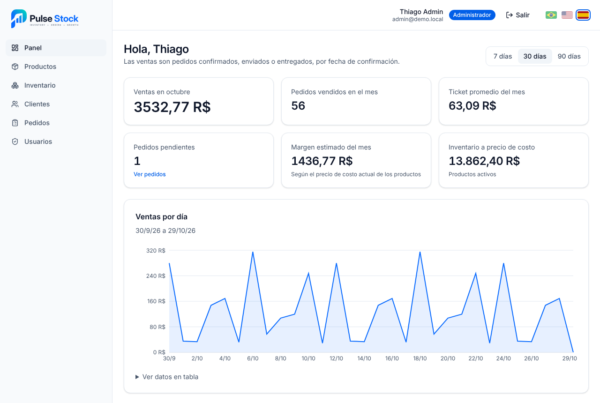
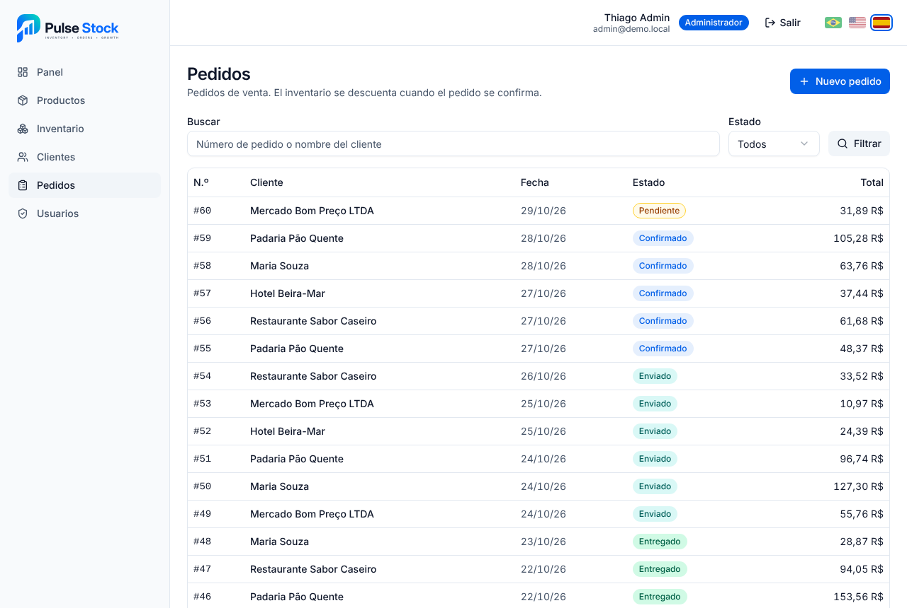
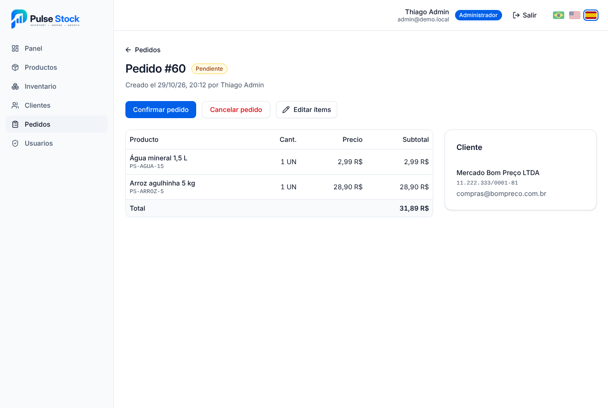
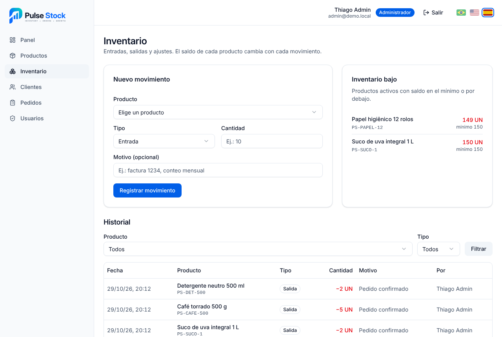
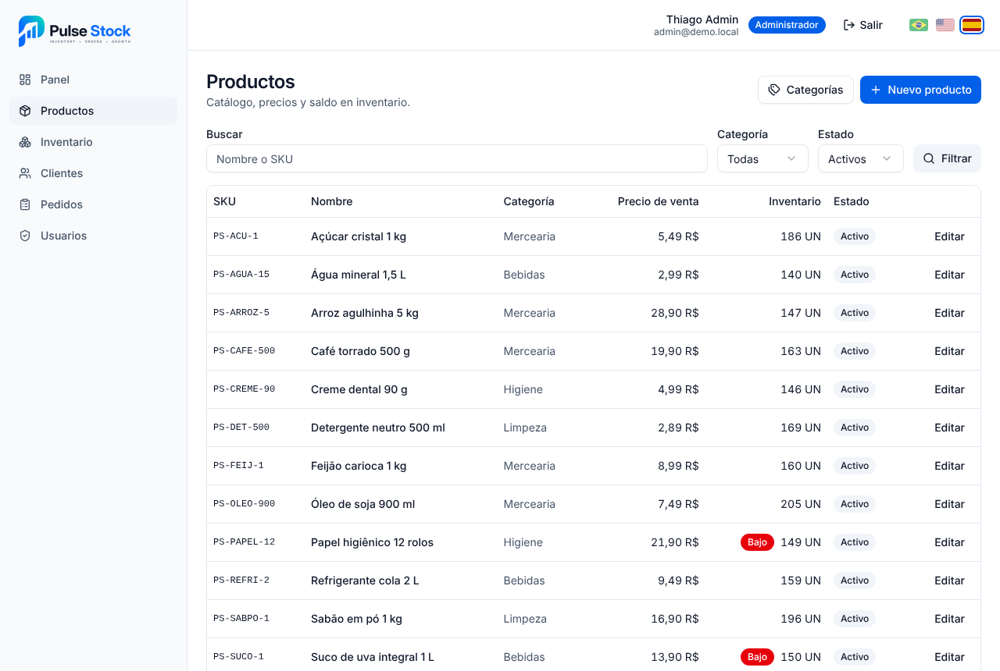
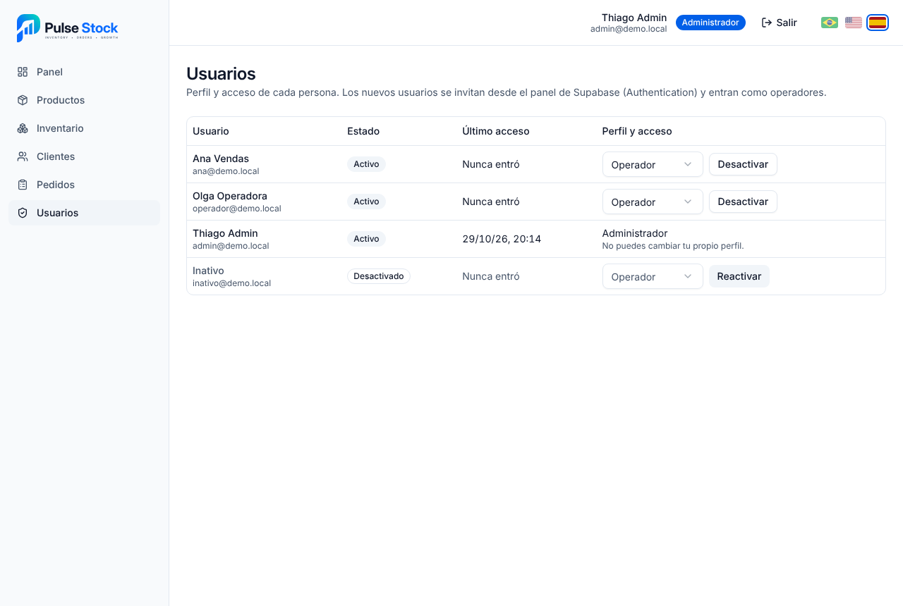
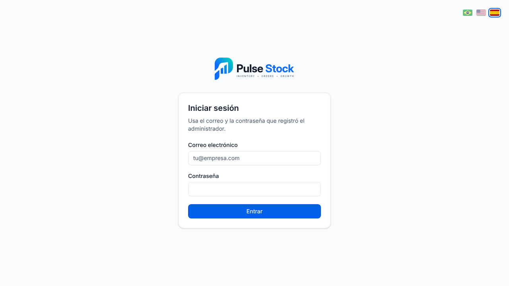
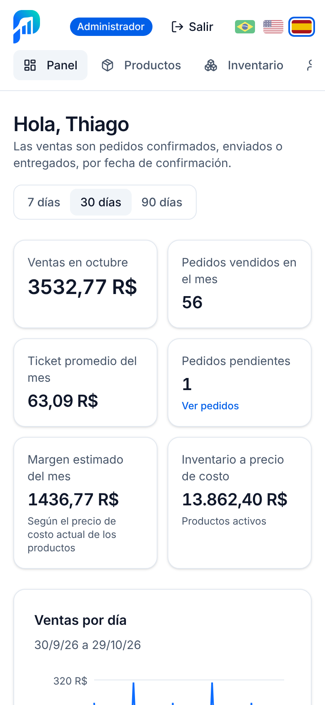

<p align="center">
  
</p>

<h1 align="center">Pulse Stock — mini ERP de inventario y pedidos</h1>

<p align="center">
  Productos, inventario, clientes, pedidos de venta y un panel con los números del mes, con las reglas de negocio garantizadas por la propia base de datos.
</p>

<p align="center">
  <a href="README.md">Português</a> · <a href="README.en.md">English</a> · <strong>Español</strong>
</p>

<p align="center">
  <a href="https://github.com/vidaltechnologies/pulsestock/actions/workflows/ci.yml"></a>
  
  
  
  
  
  
</p>

<p align="center">
  
</p>

## Sobre el proyecto

Pulse Stock es un mini ERP para una pequeña distribuidora: registra productos y clientes, controla el saldo de inventario, registra pedidos de venta y muestra en un panel cómo van las ventas. Es un proyecto de portafolio, construido en 11 etapas con un pull request para cada una.

Las reglas que no pueden fallar viven en PostgreSQL, no solo en la pantalla: permisos por perfil con Row Level Security, inventario que solo cambia por movimientos, descuento de inventario al confirmar el pedido y totales calculados por disparadores. Cada regla tiene un script de verificación que corre en la CI.

### Objetivos

- Mostrar un sistema de gestión completo, del inicio de sesión al panel, con código fácil de leer.
- Garantizar en la base de datos las reglas de acceso y de inventario, para que ninguna llamada a la API pueda saltárselas.
- Usar lo que ya ofrecen Next.js y Supabase antes de crear servicios o dependencias adicionales.
- Entregar pantallas accesibles (WCAG 2.1 AA) que funcionan en el móvil.

## Funcionalidades

- **Dos perfiles de acceso:** el administrador gestiona todo; el operador registra clientes y pedidos y anota entradas de inventario.
- **Productos y categorías:** búsqueda por nombre o SKU, filtros por categoría y estado, precios de costo y de venta e inventario mínimo.
- **Inventario:** entradas, salidas y ajustes con historial inmutable, saldo que nunca queda negativo y alerta de inventario bajo.
- **Clientes:** CPF o CNPJ brasileño con validación de los dígitos verificadores, búsqueda e inactivación.
- **Pedidos de venta:** ítems con precio congelado, total automático, flujo pendiente → confirmado → enviado → entregado y cancelación que devuelve el inventario.
- **Panel:** ventas, pedidos y ticket promedio del mes, gráficos de ventas por día, más vendidos y pedidos por estado, en periodos de 7, 30 o 90 días. El margen y el valor del inventario solo los ve el administrador.
- **Usuarios:** el administrador cambia perfiles y activa o desactiva cuentas; quien es desactivado pierde el acceso al instante.
- **Recuperación de contraseña:** enlace "¿Olvidaste tu contraseña?" en el inicio de sesión, correo con enlace de un solo uso y pantalla para crear la nueva contraseña.
- **API REST:** rutas versionadas en `/api/v1` para productos, inventario, clientes, pedidos, panel y usuarios, con token Bearer, validación en Zod, errores estandarizados, documentación OpenAPI y colección de Postman. Consulta la sección [API](#api).
- **Datos de demostración:** 16 productos, 10 clientes y unos 110 pedidos de los últimos 60 días, creados con las mismas funciones de la aplicación.
- **Tres idiomas:** portugués, inglés y español, elegidos con las banderas en la parte superior de la pantalla. Textos, mensajes de error, números y fechas cambian juntos; en la primera visita se usa el idioma del navegador.

## Pantallas

| | |
| --- | --- |
|  |  |
| Pedidos: búsqueda por número o cliente y filtro de estado | Pedido: ítems, total, cliente y acciones de estado |
|  |  |
| Inventario: movimientos, alerta de mínimo e historial | Productos: búsqueda, categoría y estado |
|  |  |
| Usuarios: perfil y acceso, solo para el administrador | Inicio de sesión |

<p align="center">
  
  <br>
  <sub>Panel en el móvil</sub>
</p>

## Tecnologías

| Tecnología | Para qué sirve |
| --- | --- |
| Next.js 16 (App Router) | Páginas renderizadas en el servidor y rutas de la API (Route Handlers) |
| React 19 + TypeScript | Interfaz y tipado de punta a punta |
| Tailwind CSS 4 + shadcn/ui | Estilos y componentes accesibles |
| Supabase (PostgreSQL + Auth) | Base de datos, inicio de sesión, RLS, disparadores y funciones |
| Zod + React Hook Form | Validación compartida entre formularios y API |
| Recharts | Gráficos del panel |
| OpenAPI 3.1 + Swagger UI | Documentación de la API, generada de los esquemas Zod |
| Vitest | Pruebas unitarias y pruebas de integración de la API |
| GitHub Actions | CI: lint, tipos, pruebas, build, verificaciones de la base de datos y pruebas de la API |

## Cómo ejecutarlo en tu computadora

Requisitos: Node.js 20.9 o superior y un proyecto en [Supabase](https://supabase.com) (o Docker, para ejecutar Supabase localmente).

```bash
git clone https://github.com/vidaltechnologies/pulsestock.git
cd pulsestock
npm install
cp .env.example .env.local   # completa la URL y la clave publicable de Supabase
npm run dev                  # http://localhost:3000
```

| Comando | Qué hace |
| --- | --- |
| `npm run dev` | Servidor de desarrollo |
| `npm run build` | Build de producción |
| `npm run lint` · `npm run typecheck` · `npm test` | ESLint, TypeScript y pruebas unitarias |
| `npm run db:start` · `npm run db:reset` | Inicia Supabase local y recrea la base con las migraciones y los datos de demostración |
| `npx supabase db push` | Aplica las migraciones al proyecto vinculado en la nube |
| `npm run db:seed` | Carga los datos de demostración en el proyecto vinculado (una sola vez) |
| `npm run db:test:rls` (y `stock`, `orders`, `dashboard`, `users`) | Verifica las reglas en la base vinculada, sin guardar nada |
| `npm run test:api:setup` · `npm run test:api:serve` · `npm run test:api` | Pruebas de integración de la API contra un Supabase local (requiere Docker) |
| `npm run postman` | Vuelve a generar las colecciones de Postman a partir de la especificación |

Los usuarios se crean en el panel de Supabase (Authentication → Users) y empiezan como operadores. La base de datos, las reglas de acceso, las rutas de la API, la CI y el despliegue en Vercel están detallados en la [referencia técnica](docs/referencia-tecnica.md) (en portugués).

## API

La app tiene su propia API REST en `/api/v1`. Supabase queda detrás, como base de datos y login: quien usa la API no habla con él directamente, y las mismas reglas de acceso de la base valen para cada llamada.

- **Documentación interactiva:** [`/api/docs`](http://localhost:3000/api/docs) (Swagger UI), con la especificación OpenAPI 3.1 en `/api/v1/openapi.json`. Sale de los mismos esquemas Zod que validan las solicitudes.
- **Autenticación:** `POST /api/v1/auth/token` cambia correo y contraseña por un `accessToken`, que va en el encabezado `Authorization: Bearer`. Cuando vence, `POST /api/v1/auth/refresh` con el `refreshToken` genera otro.
- **Convenciones:** éxito en `{ "data": ... }`, listas con `pagination`, errores en `{ "error": { "code", "message" } }` en el idioma del `Accept-Language`, orden con `sort=campo` o `sort=-campo` y `X-Request-Id` en cada respuesta.

```bash
# 1. Genera el token
curl -s -X POST http://localhost:3000/api/v1/auth/token \
  -H "Content-Type: application/json" \
  -d '{"email":"tu@ejemplo.com","password":"tu-contraseña"}'

# 2. Usa el accessToken de la respuesta: productos con inventario bajo, del menor saldo al mayor
curl -s "http://localhost:3000/api/v1/products?lowStock=true&sort=stockQuantity" \
  -H "Authorization: Bearer <accessToken>"
```

### Postman

1. En Postman, usa **Import** con dos archivos de la carpeta [`postman/`](postman/): la colección en tu idioma (`pulse-stock.es`, `.pt` o `.en.postman_collection.json`) y el entorno *Pulse Stock (local)*. En cada idioma, carpetas, nombres, descripciones y mensajes de error de la API vienen traducidos.
2. Elige el entorno en la esquina superior derecha y completa `email` y `password`. La contraseña queda solo en tu Postman.
3. Ejecuta **Autenticación → Genera un token de acceso**. El token se guarda solo y sirve para las demás solicitudes.
4. Para probar todo de una vez, ejecuta la colección en el **Collection Runner**. Cada solicitud verifica el estado, y las que crean registros guardan el id para las siguientes: categoría, producto, entrada de inventario, cliente, pedido y confirmación.

El Runner graba datos reales en la base a la que apunta `baseUrl` y pide un correo de recuperación de contraseña para tu `email`. El cambio de contraseña solo se ejecuta si completas `newPassword` en el entorno. Postman también importa la especificación directamente de `/api/v1/openapi.json`.

Las tres colecciones se generan a partir de la especificación con `npm run postman`, y una prueba falla si alguna ruta o traducción queda fuera.

### Pruebas de integración

`npm run test:api:setup` inicia un Supabase local desechable (requiere Docker) con usuarios de prueba, `npm run test:api:serve` compila e inicia la app en el puerto 3100 y `npm run test:api` ejecuta las pruebas. La CI hace lo mismo en cada push y además ejecuta las tres colecciones de Postman completas con [Newman](https://github.com/postmanlabs/newman).

## Estructura del código

```text
pulsestock/
├── src/
│   ├── app/
│   │   ├── (app)/          # pantallas con sesión: panel, productos, inventario, clientes, pedidos, usuarios
│   │   ├── (auth)/login/   # pantalla de inicio de sesión
│   │   ├── api/            # API REST v1 (Route Handlers) y documentación en /api/docs
│   │   └── sair/           # cierra la sesión de un usuario desactivado
│   ├── components/         # componentes por módulo y componentes shadcn/ui
│   ├── lib/
│   │   ├── data/           # acceso a Supabase por módulo
│   │   ├── openapi/        # especificación OpenAPI y colección de Postman
│   │   ├── supabase/       # clientes de Supabase (servidor y navegador)
│   │   └── validations/    # esquemas Zod y pruebas
│   ├── types/              # tipos generados de la base de datos
│   └── proxy.ts            # renueva la sesión en cada solicitud
├── supabase/
│   ├── migrations/         # esquema, RLS, inventario, pedidos, panel y usuarios
│   ├── tests/              # verificaciones SQL de las reglas de negocio
│   └── seed.sql            # datos de demostración
├── postman/                # colección y entorno de Postman
├── scripts/                # Supabase local y app para las pruebas de la API
├── tests/api/              # pruebas de integración de la API
├── docs/                   # ícono, pantallas y referencia técnica
└── .github/workflows/      # CI
```

---

<p align="center">© Vidal Technologies. Todos los derechos reservados.</p>
