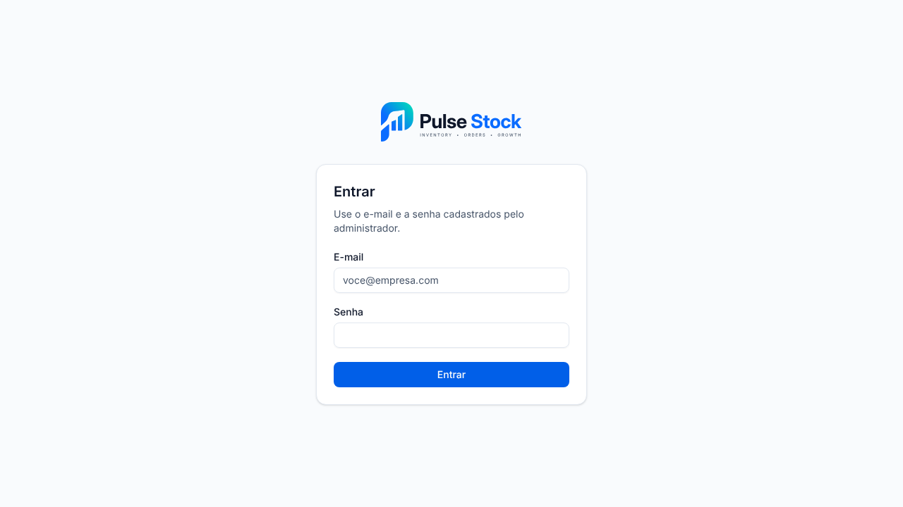

<p align="center">
  
</p>

<h1 align="center">Pulse Stock — mini ERP de estoque e pedidos</h1>

<p align="center">
  Produtos, estoque, clientes, pedidos de venda e um dashboard com os números do mês, com as regras de negócio garantidas no próprio banco de dados.
</p>

<p align="center">
  <strong>Português</strong> · <a href="README.en.md">English</a> · <a href="README.es.md">Español</a>
</p>

<p align="center">
  <a href="https://github.com/vidaltechnologies/pulsestock/actions/workflows/ci.yml"></a>
  
  
  
  
  
  
</p>

<p align="center">
  
</p>

## Sobre o projeto

O Pulse Stock é um mini ERP para uma pequena distribuidora: cadastra produtos e clientes, controla o saldo de estoque, registra pedidos de venda e mostra no dashboard como as vendas andam. É um projeto de portfólio, construído em 11 etapas com um pull request para cada uma.

As regras que não podem falhar ficam no PostgreSQL, não só na tela: permissões por perfil com Row Level Security, saldo de estoque alterado só por movimentações, baixa de estoque na confirmação do pedido e totais calculados por gatilho. Cada regra tem um script de verificação que roda no CI.

### Objetivos

- Mostrar um sistema de gestão completo, do login ao dashboard, com código simples de ler.
- Garantir no banco as regras de acesso e de estoque, para que nenhuma chamada à API consiga burlá-las.
- Usar os recursos do Next.js e do Supabase antes de criar serviços ou dependências extras.
- Entregar telas acessíveis (WCAG 2.1 AA) que funcionam no celular.

## Funcionalidades

- **Dois perfis de acesso:** o administrador gerencia tudo; o operador cadastra clientes e pedidos e registra entradas de estoque.
- **Produtos e categorias:** busca por nome ou SKU, filtros por categoria e status, preços de custo e de venda e estoque mínimo.
- **Estoque:** entradas, saídas e ajustes com histórico imutável, saldo que nunca fica negativo e alerta de estoque baixo.
- **Clientes:** CPF ou CNPJ com validação dos dígitos verificadores, busca e inativação.
- **Pedidos de venda:** itens com preço congelado, total automático, fluxo pendente → confirmado → enviado → entregue e cancelamento que devolve o estoque.
- **Dashboard:** vendas, pedidos e ticket médio do mês, gráficos de vendas por dia, mais vendidos e pedidos por status, com períodos de 7, 30 ou 90 dias. Margem e valor do estoque aparecem só para o administrador.
- **Usuários:** o administrador muda o perfil e ativa ou desativa contas; quem é desativado perde o acesso na hora.
- **Recuperação de senha:** link "Esqueci minha senha" no login, e-mail com link de uso único e tela para criar a nova senha.
- **API REST:** rotas para produtos, estoque, clientes, pedidos, dashboard e usuários, com validação em Zod e erros padronizados.
- **Dados de demonstração:** 16 produtos, 10 clientes e cerca de 110 pedidos dos últimos 60 dias, criados pelas mesmas funções do app.
- **Três idiomas:** português, inglês e espanhol, escolhidos pelas bandeiras no topo da tela. Textos, mensagens de erro, números e datas mudam juntos; na primeira visita vale o idioma do navegador.

## Telas

| | |
| --- | --- |
|  |  |
| Pedidos: busca por número ou cliente e filtro de status | Pedido: itens, total, cliente e ações de status |
|  |  |
| Estoque: movimentação, alerta de mínimo e histórico | Produtos: busca, categoria e status |
|  |  |
| Usuários: perfil e acesso, só para o administrador | Login |

<p align="center">
  
  <br>
  <sub>Dashboard no celular</sub>
</p>

## Tecnologias

| Tecnologia | Para que serve |
| --- | --- |
| Next.js 16 (App Router) | Páginas renderizadas no servidor e rotas da API (Route Handlers) |
| React 19 + TypeScript | Interface e tipagem de ponta a ponta |
| Tailwind CSS 4 + shadcn/ui | Estilo e componentes acessíveis |
| Supabase (PostgreSQL + Auth) | Banco de dados, login, RLS, gatilhos e funções |
| Zod + React Hook Form | Validação compartilhada entre formulários e API |
| Recharts | Gráficos do dashboard |
| Vitest | Testes unitários das validações |
| GitHub Actions | CI: lint, tipos, testes, build e verificações do banco |

## Como rodar no seu computador

Requisitos: Node.js 20.9 ou superior e um projeto no [Supabase](https://supabase.com) (ou Docker, para rodar o Supabase localmente).

```bash
git clone https://github.com/vidaltechnologies/pulsestock.git
cd pulsestock
npm install
cp .env.example .env.local   # preencha a URL e a chave publicável do Supabase
npm run dev                  # http://localhost:3000
```

| Comando | O que faz |
| --- | --- |
| `npm run dev` | Servidor de desenvolvimento |
| `npm run build` | Build de produção |
| `npm run lint` · `npm run typecheck` · `npm test` | ESLint, TypeScript e testes unitários |
| `npm run db:start` · `npm run db:reset` | Sobe o Supabase local e recria o banco com as migrações e os dados de demonstração |
| `npx supabase db push` | Aplica as migrações no projeto vinculado da nuvem |
| `npm run db:seed` | Carrega os dados de demonstração no projeto vinculado (uma vez só) |
| `npm run db:test:rls` (e `stock`, `orders`, `dashboard`, `users`) | Verifica as regras no banco vinculado, sem gravar nada |

Os usuários são criados no painel do Supabase (Authentication → Users) e nascem como operador. Banco, regras de acesso, rotas da API, CI e deploy na Vercel estão detalhados na [referência técnica](docs/referencia-tecnica.md).

## Estrutura do código

```text
pulsestock/
├── src/
│   ├── app/
│   │   ├── (app)/          # telas logadas: dashboard, produtos, estoque, clientes, pedidos, usuários
│   │   ├── (auth)/login/   # tela de login
│   │   ├── api/            # rotas REST (Route Handlers)
│   │   └── sair/           # encerra a sessão de usuário desativado
│   ├── components/         # componentes por módulo e componentes shadcn/ui
│   ├── lib/
│   │   ├── data/           # acesso ao Supabase por módulo
│   │   ├── supabase/       # clientes do Supabase (servidor e navegador)
│   │   └── validations/    # esquemas Zod e testes
│   ├── types/              # tipos gerados do banco
│   └── proxy.ts            # renova a sessão a cada requisição
├── supabase/
│   ├── migrations/         # esquema, RLS, estoque, pedidos, dashboard e usuários
│   ├── tests/              # verificações SQL das regras de negócio
│   └── seed.sql            # dados de demonstração
├── docs/                   # ícone, telas e referência técnica
└── .github/workflows/      # CI
```

---

<p align="center">© Vidal Technologies. Todos os direitos reservados.</p>
