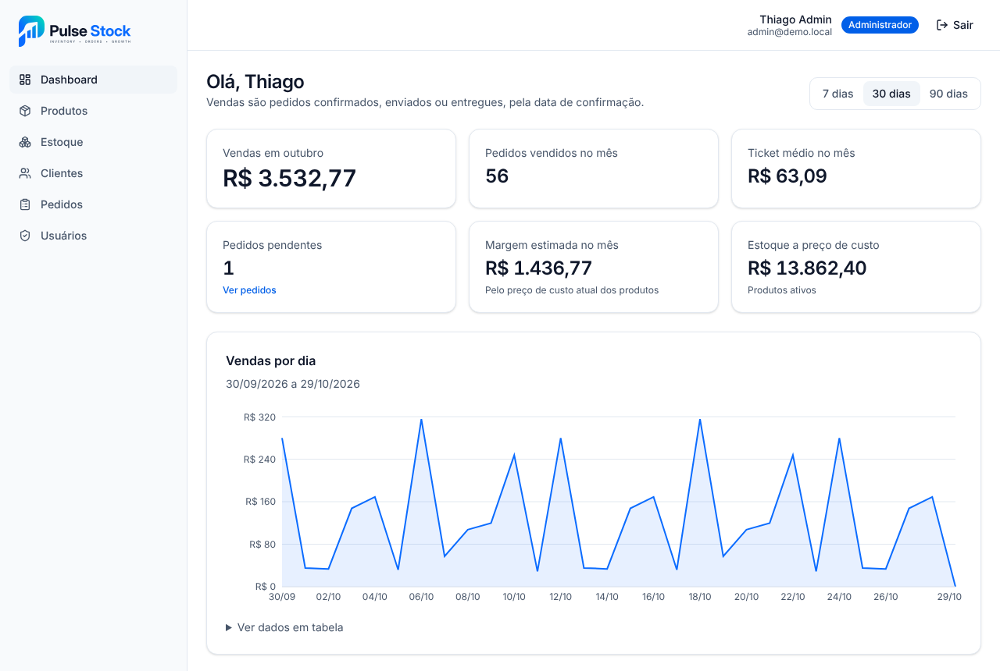
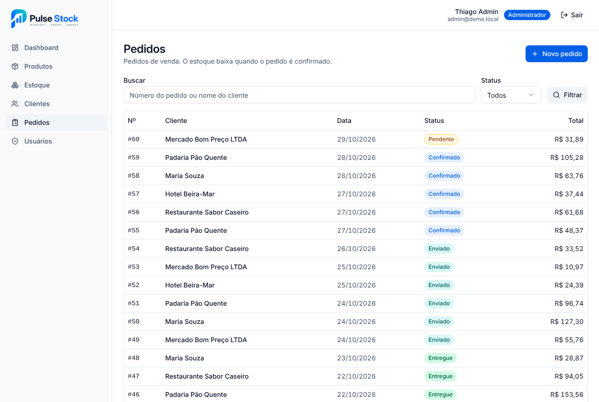
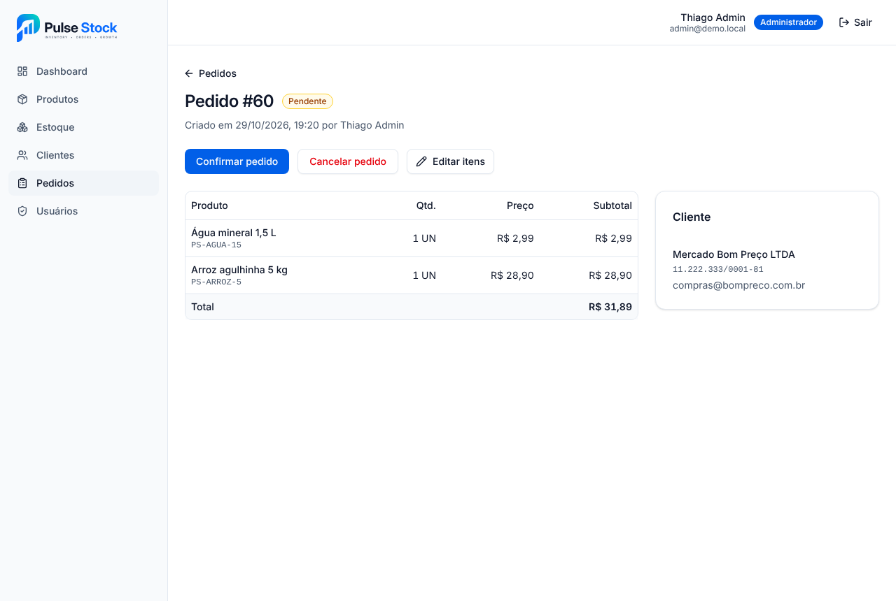
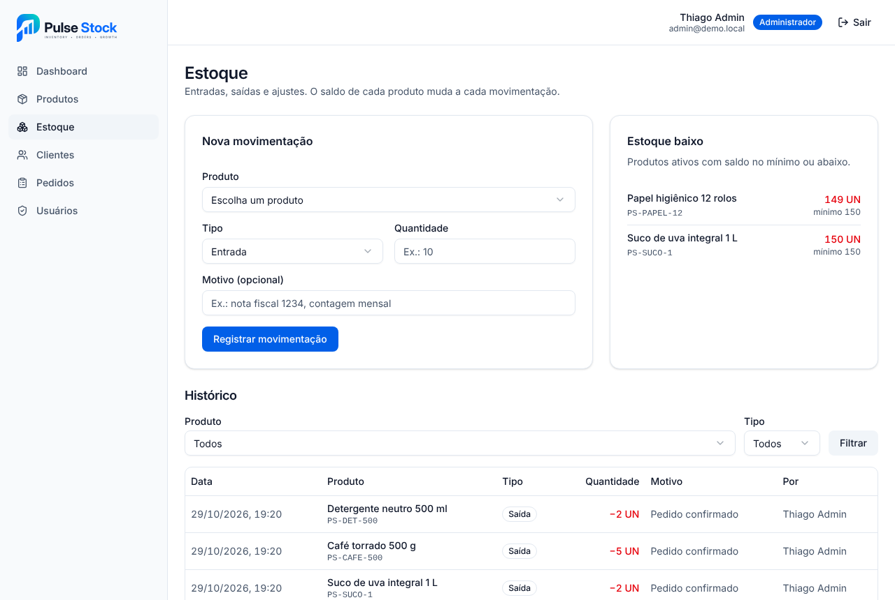
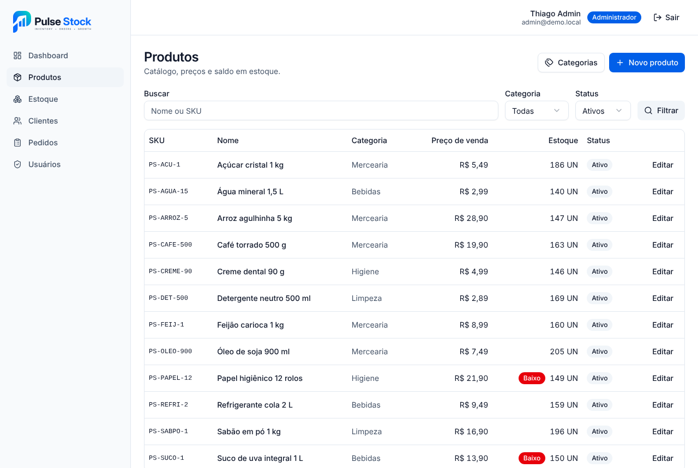
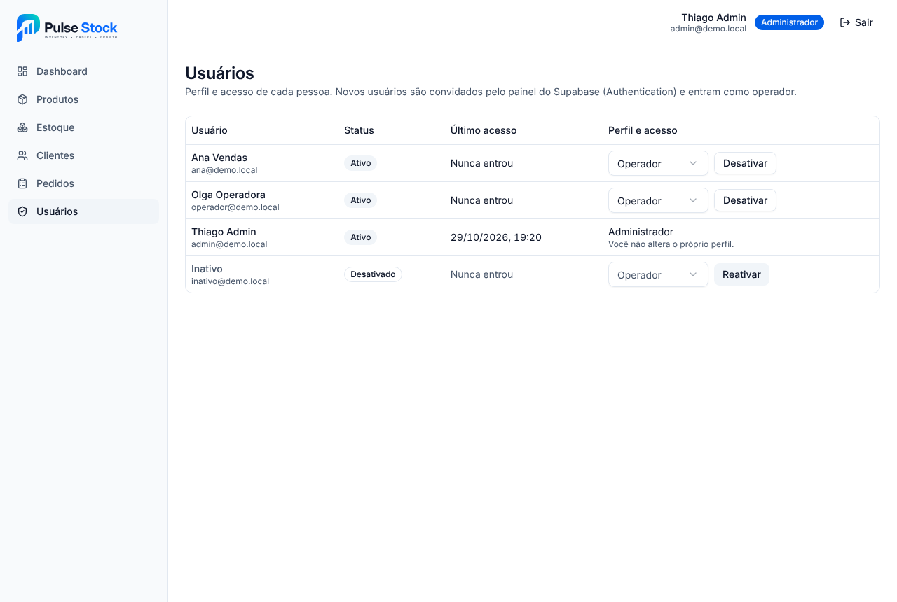
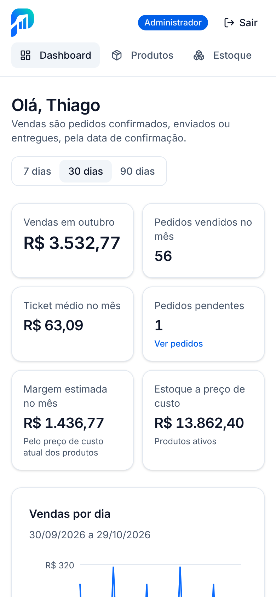

# Pulse Stock

[](https://github.com/vidaltechnologies/pulsestock/actions/workflows/ci.yml)

Mini ERP de estoque e pedidos de venda, feito como projeto de portfólio.



**Stack:** Next.js 16 (App Router) · React 19 · TypeScript · Tailwind CSS 4 · shadcn/ui · Supabase (PostgreSQL + Auth) · Zod · Recharts

## Status

| Etapa | Conteúdo | Situação |
| --- | --- | --- |
| 0 | Base Next.js, Tailwind, shadcn/ui e identidade visual | Concluída |
| 1 | Esquema do banco (enums, tabelas, restrições, índices) e tipos TypeScript | Concluída |
| 2 | Login com Supabase Auth, proxy de sessão e layout logado | Concluída |
| 3 | Perfis de acesso e políticas RLS | Concluída |
| 4 | Produtos e categorias: API, listagem com busca e cadastro | Concluída |
| 5 | Estoque: movimentações, saldo por gatilho e alerta de mínimo | Concluída |
| 6 | Clientes: cadastro com validação de CPF/CNPJ, busca e edição | Concluída |
| 7 | Pedidos: itens, total automático, confirmação com baixa de estoque e cancelamento | Concluída |
| 8 | Dashboard: indicadores do mês e gráficos de vendas, mais vendidos e pedidos por status | Concluída |
| 9 | Usuários: tela do admin para mudar perfil e ativar ou desativar | Concluída |
| 10 | Dados de demonstração, CI, revisão de acessibilidade e deploy | Concluída |

## Telas

| | |
| --- | --- |
|  |  |
| Pedidos: busca por número ou cliente e filtro de status | Pedido: itens, total, cliente e ações de status |
|  |  |
| Estoque: movimentação, alerta de mínimo e histórico | Produtos: busca, categoria e status |
|  |  |
| Usuários: perfil e acesso, só para o admin | Dashboard no celular |

## Requisitos

- Node.js 20.9 ou superior
- Docker, para rodar o Supabase localmente (opcional)

## Como rodar

```bash
npm install
cp .env.example .env.local   # preencha a chave publicável do Supabase
npm run dev                  # http://localhost:3000
```

## Banco de dados

As migrações ficam em `supabase/migrations/`. A Supabase CLI já vem como dependência de desenvolvimento.

**Supabase local (Docker):**

```bash
npm run db:start   # sobe o Supabase local
npm run db:reset   # recria o banco aplicando as migrações e os dados de demonstração
```

**Projeto na nuvem:**

```bash
npx supabase login
npx supabase link --project-ref qhkemlxytksotndoxtak
npx supabase db push
```

`login` e `link` pedem o token de acesso e a senha do banco no seu terminal. Eles não devem ser salvos no repositório.

### Dados de demonstração

`supabase/seed.sql` cria 4 categorias, 16 produtos, 10 clientes e cerca de 110 pedidos espalhados pelos últimos 60 dias (a maioria entregue, alguns enviados, confirmados, pendentes e cancelados), além de 3 produtos com estoque baixo. Os pedidos passam pelas mesmas funções do app, então saldos, totais e histórico ficam coerentes.

- Não cria usuários nem senhas. Pedidos e movimentações ficam em nome do primeiro administrador ativo; sem administrador, só catálogo e clientes são criados.
- Roda uma vez só: se já existirem produtos com SKU `PS-`, não faz nada.
- No banco local roda junto com `npm run db:reset`. No projeto na nuvem: `npm run db:seed`.

### Modelo de dados

| Tabela | Uso |
| --- | --- |
| `profiles` | Perfil de cada usuário do Supabase Auth (`admin` ou `operator`) |
| `categories` | Categorias de produto |
| `products` | Catálogo, preços e saldo de estoque (nunca negativo) |
| `stock_movements` | Histórico imutável de entradas, saídas e ajustes |
| `customers` | Clientes com CPF ou CNPJ |
| `orders` | Pedidos de venda e seu status |
| `order_items` | Itens do pedido com preço congelado no momento da venda |

O estoque é baixado quando o pedido é confirmado.

## Autenticação

- Login por e-mail e senha (Supabase Auth). O cadastro público fica desativado: usuários são criados pelo painel do Supabase.
- Cada usuário novo ganha um perfil `operator` automaticamente. Para tornar alguém administrador, rode no SQL Editor do Supabase:

  ```sql
  update public.profiles
  set role = 'admin'
  where id = (select id from auth.users where email = 'seu-email@exemplo.com');
  ```

- `src/proxy.ts` renova a sessão a cada requisição e manda para `/login` quem acessa a área logada sem sessão. A autorização de fato acontece nas páginas, na API e no RLS.
- A sessão fica em cookies `httpOnly`, lidos só no servidor.

| Rota | Uso |
| --- | --- |
| `POST /api/auth/login` | `{ email, password }` validado com Zod. 401 para credenciais erradas, 403 para usuário desativado |
| `POST /api/auth/logout` | Encerra a sessão |
| `GET /api/me` | Usuário logado e perfil (401 sem sessão) |

## Perfis de acesso

As regras ficam no banco (RLS e privilégios por coluna, em `supabase/migrations/20261029000003_rls_policies.sql`) e são repetidas no app para mostrar só o que cada perfil pode fazer.

| Recurso | Administrador | Operador |
| --- | --- | --- |
| Perfis | Lê todos; altera nome, perfil e status (o próprio, só o nome) | Lê o próprio |
| Produtos e categorias | Cria, edita e inativa | Consulta |
| Estoque | Entradas, saídas manuais e ajustes | Entradas |
| Clientes | Cria, edita e inativa | Cria e edita |
| Pedidos e itens | Cria, edita enquanto pendente, muda status e cancela | Cria, edita enquanto pendente e muda status (sem cancelar) |

- Sem login (`anon`) e com perfil inativo, nenhuma tabela é acessível.
- Nada é excluído fisicamente, exceto itens de pedido pendente. Registros são inativados.
- Saldo de estoque, status e total do pedido não podem ser alterados direto pela API. Eles mudam só pelas funções das etapas de estoque e pedidos.

Para conferir as regras no banco, rode `npm run db:test:rls`. O script `supabase/tests/rls_check.sql` cria usuários e dados de teste dentro de uma transação, testa 45 operações por perfil e desfaz tudo no final.

## Produtos

Telas em `/produtos` (lista com busca por nome ou SKU, filtro por categoria e status, paginação de 20 itens), `/produtos/novo`, `/produtos/{id}` e `/produtos/categorias`. O operador só consulta; cadastro, edição, inativação e categorias são do administrador.

| Rota | Uso | Perfil |
| --- | --- | --- |
| `GET /api/products` | Lista. Filtros: `q`, `categoryId`, `status` (`active`, `inactive`, `all`), `page`, `pageSize` (até 100) | Ambos |
| `POST /api/products` | Cadastra. Corpo: `sku`, `name`, `salePrice` e opcionais `description`, `categoryId`, `unit`, `costPrice`, `minStock` | Admin |
| `GET /api/products/{id}` | Detalhe | Ambos |
| `PATCH /api/products/{id}` | Edição parcial. Inativar: `{ "active": false }` | Admin |
| `GET /api/categories` · `POST /api/categories` | Lista e cadastra categorias (`{ "name" }`) | Ambos · Admin |

- Erros seguem `{ error: { code, message, details } }`: 400 com mensagens por campo, 401, 403, 404 e 409 para SKU ou categoria repetidos.
- O saldo (`stockQuantity`) é só leitura: o produto nasce com zero e o saldo muda pelas movimentações de estoque (etapa 5).
- A validação fica em `src/lib/validations/product.ts` e é a mesma no formulário e na API. Os testes estão em `product.test.ts` (`npm test`).

## Estoque

O saldo (`products.stock_quantity`) só muda por movimentações em `stock_movements`. Um gatilho no banco (`20261029000004_stock.sql`) aplica cada movimentação ao saldo na mesma transação, travando o produto para que movimentações simultâneas não se atropelem. Uma saída ou um ajuste que deixaria o saldo negativo é recusado, e nada é gravado.

| Tipo | Quantidade | Quem registra |
| --- | --- | --- |
| Entrada | Positiva, soma ao saldo | Admin e operador |
| Saída | Positiva, subtrai do saldo | Admin |
| Ajuste | Diferença com sinal (ex.: `-3`) | Admin |

- A tela `/estoque` tem o formulário de movimentação, o alerta de estoque baixo (produtos ativos com saldo no mínimo ou abaixo, pela coluna gerada `low_stock`) e o histórico com filtros por produto e tipo.
- O histórico mostra quem fez cada movimentação. Como o operador só lê o próprio perfil, os nomes vêm da função `user_display_names`, que devolve apenas id e nome.
- O histórico é imutável: não há edição nem exclusão. Para corrigir, registre um ajuste.

| Rota | Uso | Perfil |
| --- | --- | --- |
| `GET /api/stock-movements` | Histórico. Filtros: `productId`, `type` (`in`, `out`, `adjustment`), `page`, `pageSize` | Ambos |
| `POST /api/stock-movements` | `{ productId, type, quantity, reason? }`. Devolve a movimentação e o novo saldo. Saldo insuficiente → 409 `insufficient_stock` | Entrada: ambos · Saída e ajuste: admin |

Para conferir as regras de saldo no banco, rode `npm run db:test:stock` (22 verificações, sem gravar nada).

## Clientes

Telas em `/clientes` (lista com busca por nome, e-mail ou CPF/CNPJ e filtro de status), `/clientes/novo` e `/clientes/{id}`. Admin e operador cadastram e editam; só o admin inativa ou reativa.

- CPF e CNPJ são opcionais, mas quando informados precisam ter os dígitos verificadores corretos. Aceitam máscara e são gravados só com números (únicos no banco).
- E-mail é gravado em minúsculas, e a UF é escolhida da lista dos 27 estados.

| Rota | Uso | Perfil |
| --- | --- | --- |
| `GET /api/customers` | Lista. Filtros: `q`, `status` (`active`, `inactive`, `all`), `page`, `pageSize` | Ambos |
| `POST /api/customers` | `{ name, document?, email?, phone?, city?, state? }`. Documento repetido → 409 | Ambos |
| `GET /api/customers/{id}` | Detalhe | Ambos |
| `PATCH /api/customers/{id}` | Edição parcial. `active` só para admin (403 para operador) | Ambos |

## Pedidos

Telas em `/pedidos` (lista com busca por número ou nome do cliente e filtro de status), `/pedidos/novo`, `/pedidos/{id}` (detalhe com as ações de status) e `/pedidos/{id}/editar` (só enquanto pendente).

O pedido é gravado pela função `save_order` e o status muda só por `change_order_status`, ambas em `20261029000005_orders.sql`. Cada uma roda numa transação: ou tudo é gravado, ou nada.

- O preço de cada item é o preço de venda do produto no momento em que ele entra no pedido. O total é recalculado por gatilho e não pode ser gravado pela API.
- O mesmo produto repetido vira um item só, com as quantidades somadas. Produto inativo não entra em pedido.
- O estoque só baixa quando o pedido é confirmado. A confirmação confere o saldo de todos os itens antes de baixar qualquer um: se faltar saldo de um, nada é baixado e a resposta diz qual produto e quanto há. Cada item gera uma saída em `stock_movements` ligada ao pedido.
- Cancelar um pedido confirmado devolve o estoque com entradas ligadas ao pedido.

| De | Para | Quem |
| --- | --- | --- |
| Pendente | Confirmado | Ambos |
| Confirmado | Enviado | Ambos |
| Enviado | Entregue | Ambos |
| Pendente ou confirmado | Cancelado | Admin |

| Rota | Uso | Perfil |
| --- | --- | --- |
| `GET /api/orders` | Lista. Filtros: `q` (número ou cliente), `status`, `customerId`, `page`, `pageSize` | Ambos |
| `POST /api/orders` | `{ customerId, items: [{ productId, quantity }], notes? }`. Devolve o pedido (201) | Ambos |
| `GET /api/orders/{id}` | Detalhe com cliente e itens | Ambos |
| `PATCH /api/orders/{id}` | Mesmo corpo do POST; substitui cliente, itens e observações. Pedido não pendente → 409 `not_editable` | Ambos |
| `POST /api/orders/{id}/status` | `{ status }` (`confirmed`, `shipped`, `delivered`, `cancelled`). Erros 409: `insufficient_stock`, `inactive_product`, `invalid_transition` | Ambos · Cancelar: admin |

Para conferir as regras no banco, rode `npm run db:test:orders` (37 verificações, sem gravar nada).

## Dashboard

A tela `/dashboard` mostra os indicadores do mês e três gráficos do período escolhido (7, 30 ou 90 dias, pela URL `?periodo=`). Os números são calculados no banco pela função `dashboard_summary` (`20261029000006_dashboard.sql`), numa consulta só.

- Venda é um pedido confirmado, enviado ou entregue, contado pela data de confirmação. Pendentes e cancelados ficam fora dos valores.
- Os dias são agrupados no fuso de São Paulo: uma venda confirmada às 23h é do dia dela, mesmo que já seja o dia seguinte em UTC.
- Indicadores: vendas do mês, pedidos vendidos no mês, ticket médio (vendas ÷ pedidos) e pedidos pendentes. Gráficos: vendas por dia, os 5 produtos mais vendidos (por valor) e pedidos criados no período por status. Abaixo, os produtos com estoque baixo.
- Só o administrador vê a margem estimada do mês e o valor do estoque a preço de custo. A margem usa o custo atual do produto, porque o item do pedido não guarda o custo da época. Para o operador, a função devolve esses campos como `null`.

| Rota | Uso | Perfil |
| --- | --- | --- |
| `GET /api/dashboard` | Indicadores e séries. Filtro: `days` (7, 30 ou 90; padrão 30) | Ambos |

Para conferir os números no banco, rode `npm run db:test:dashboard` (28 verificações, sem gravar nada). O script cria pedidos de teste, compara o resultado com o que era antes e desfaz tudo.

## Usuários

Tela `/usuarios`, só para o administrador (o operador não vê o menu e volta ao dashboard se abrir o endereço). Mostra nome, e-mail, status e último acesso de cada pessoa, com o perfil e o botão de desativar ou reativar na própria linha.

- Novos usuários são criados ou convidados no painel do Supabase (Authentication → Users). O perfil nasce como operador e ativo.
- O e-mail e o último acesso ficam em `auth.users`, fora do alcance da API; a função `list_users` (`20261029000007_users.sql`) os devolve só para o administrador.
- O administrador não muda o próprio perfil nem desativa a si mesmo (a API responde 409 `self_change` e o banco também recusa). Assim sempre sobra ao menos um administrador ativo.
- Desativar corta o acesso na hora: o banco deixa de responder a esse usuário, a API devolve 401 e, se ele estiver com o sistema aberto, a próxima página encerra a sessão e mostra o aviso no login.

| Rota | Uso | Perfil |
| --- | --- | --- |
| `GET /api/users` | Lista com e-mail, perfil, status e último acesso | Admin |
| `PATCH /api/users/{id}` | `{ fullName?, role?, active? }`. O próprio perfil ou status → 409 | Admin |

Para conferir as regras no banco, rode `npm run db:test:users` (22 verificações, sem gravar nada).

## Integração contínua

O workflow `.github/workflows/ci.yml` roda em cada pull request e em cada push na `main`:

1. **App:** `npm ci`, lint, typecheck, testes unitários e build.
2. **Banco:** sobe o Postgres local do Supabase no runner, aplica todas as migrações, cria um administrador de teste, carrega os dados de demonstração e roda as cinco verificações (`supabase/tests/*_check.sql`). Qualquer verificação que falhar derruba o job.

## Deploy na Vercel

O app roda na Vercel sem configuração extra (Next.js é detectado sozinho). Só duas variáveis são necessárias, e as duas são públicas: a URL do projeto e a chave publicável. A chave secreta do Supabase não é usada pelo app.

1. Em [vercel.com/new](https://vercel.com/new), importe o repositório `vidaltechnologies/pulsestock`.
2. Em **Environment Variables**, adicione:
   - `NEXT_PUBLIC_SUPABASE_URL` = `https://qhkemlxytksotndoxtak.supabase.co`
   - `NEXT_PUBLIC_SUPABASE_PUBLISHABLE_KEY` = a chave publicável (Supabase → Project Settings → API Keys)
3. Clique em **Deploy**.
4. No Supabase, em **Authentication → URL Configuration**, troque o **Site URL** pelo endereço da Vercel (por exemplo `https://pulsestock.vercel.app`). Os e-mails de convite e de troca de senha passam a apontar para o site publicado.

Cada push na `main` gera um novo deploy, e cada pull request ganha um endereço de prévia.

## Acessibilidade

As telas principais (login, dashboard, produtos, estoque, clientes, pedidos e usuários) passam sem violações na verificação automática do [axe-core](https://github.com/dequelabs/axe-core) com as regras WCAG 2.1 AA. Para isso o azul dos botões e textos (`--primary`) é um tom um pouco mais escuro do azul da marca, com contraste acima de 4,5:1. Os gráficos têm tooltip e a opção "Ver dados em tabela", e todas as telas funcionam no celular sem rolagem horizontal.

## Scripts

| Comando | O que faz |
| --- | --- |
| `npm run dev` | Servidor de desenvolvimento |
| `npm run build` | Build de produção |
| `npm run lint` | ESLint |
| `npm run typecheck` | Gera os tipos de rota do Next.js e roda o TypeScript |
| `npm test` | Testes unitários (Vitest) |
| `npm run db:start` / `db:stop` | Sobe ou para o Supabase local |
| `npm run db:reset` | Recria o banco local com as migrações |
| `npm run db:test:rls` | Verifica as regras de acesso no projeto vinculado (sem gravar nada) |
| `npm run db:test:stock` | Verifica as regras de saldo de estoque no projeto vinculado (sem gravar nada) |
| `npm run db:test:orders` | Verifica as regras de pedidos no projeto vinculado (sem gravar nada) |
| `npm run db:test:dashboard` | Confere os números do dashboard no projeto vinculado (sem gravar nada) |
| `npm run db:test:users` | Verifica as regras de usuários no projeto vinculado (sem gravar nada) |
| `npm run db:seed` | Carrega os dados de demonstração no projeto vinculado (uma vez só) |
| `npm run db:types` | Gera os tipos TypeScript a partir do projeto Supabase vinculado |
